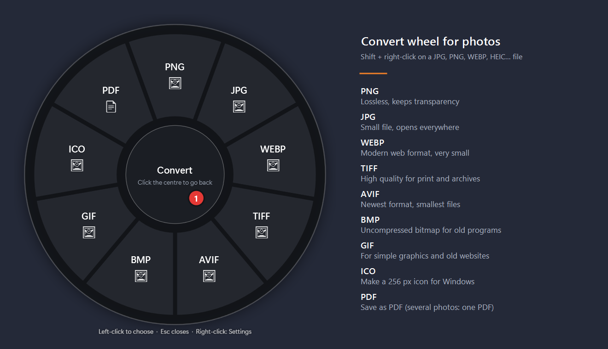
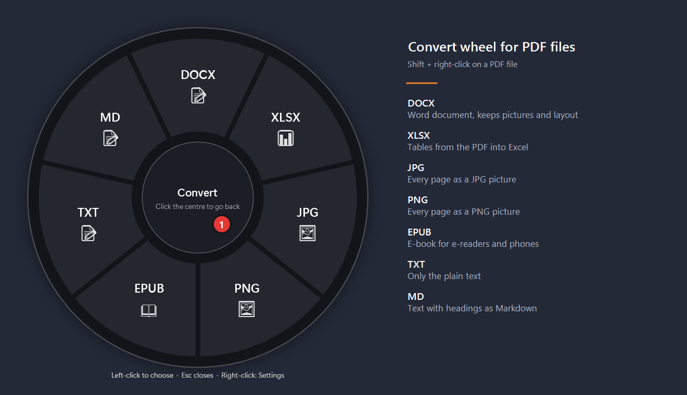
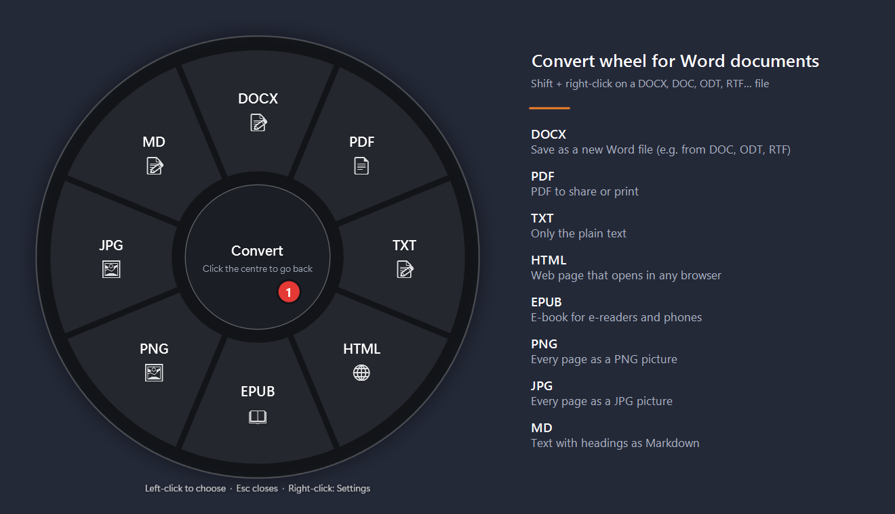
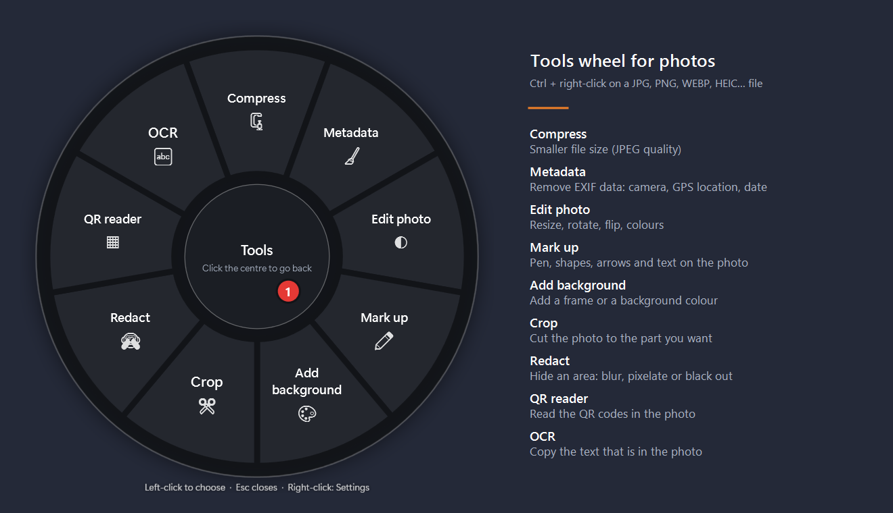
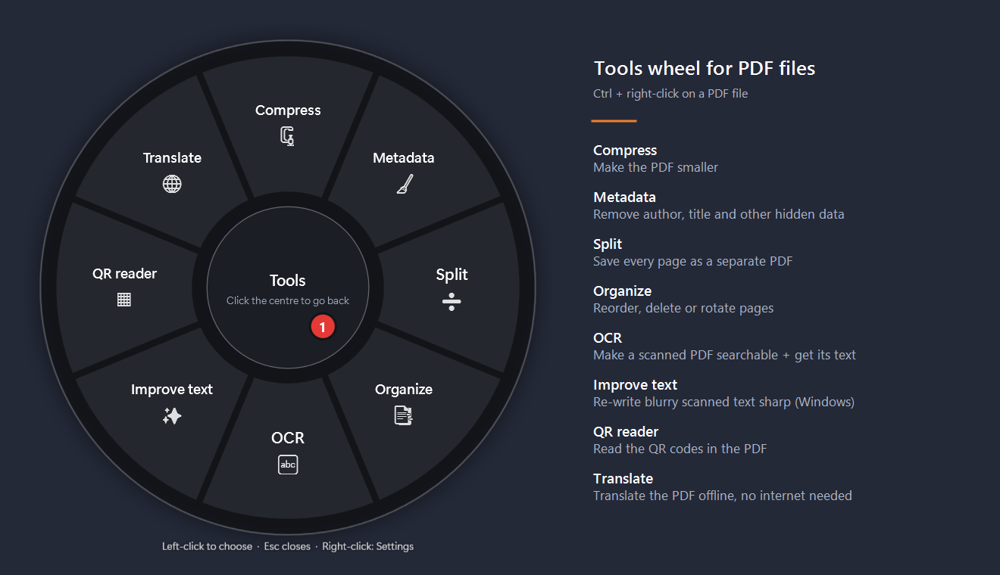
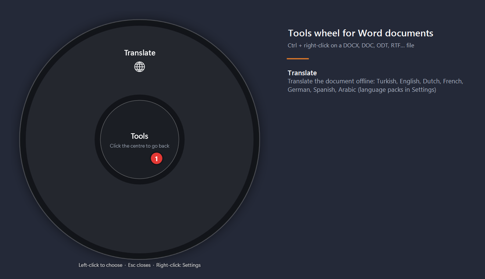
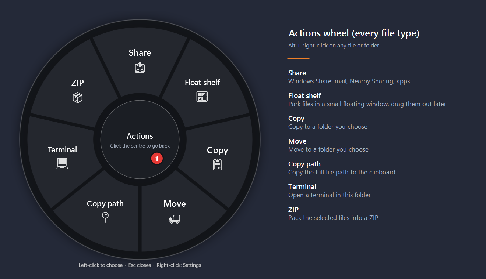
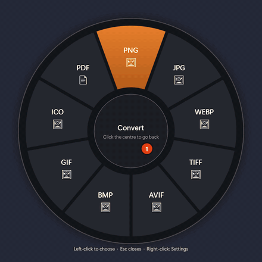
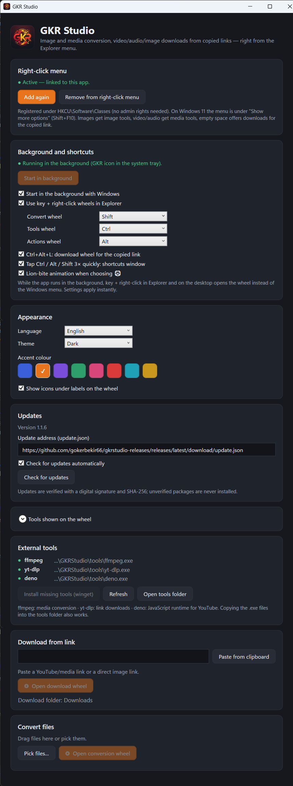

<p align="center"></p>

# GKR Studio

> Versions before 1.2.0 cannot update themselves to this release: install GKR Studio once with the links below (settings carry over).

Convert, edit and download files straight from a radial wheel — on **Windows** and **macOS**.

<p align="center">
  
</p>

Right-click without a key opens the wheel above with three parts: **Convert**, **Tools** and **Actions**. With a key held you go straight to one part: **Shift** = Convert, **Ctrl** = Tools, **Alt** = Actions (Windows defaults; the keys can be changed in Settings).

## Convert wheel: what each format is for

The **Convert** wheel (Shift + right-click) shows the formats that make sense for the file type.

**Photos**
<p align="center"></p>

**PDF files**
<p align="center"></p>

**Word documents**
<p align="center"></p>

## Tools wheel: what each tool does

The **Tools** wheel (Ctrl + right-click) shows different tools for each file type.

**Photos**
<p align="center"></p>

**PDF files**
<p align="center"></p>

**Word documents**
<p align="center"></p>

## Actions wheel: what each action does

The **Actions** wheel (Alt + right-click) is the same for every file type and also works on folders.

<p align="center"></p>

## Download

| Platform | Package |
|---|---|
| Windows 10/11 (64-bit) | [GKRStudio-win-x64.zip](https://github.com/gokerbekir66/gkrstudio-releases/releases/latest/download/GKRStudio-win-x64.zip) |
| Mac with Apple silicon (M-series, A-series) | [GKRStudio-macos-arm64.zip](https://github.com/gokerbekir66/gkrstudio-releases/releases/latest/download/GKRStudio-macos-arm64.zip) |
| Mac with Intel processor | [GKRStudio-macos-x64.zip](https://github.com/gokerbekir66/gkrstudio-releases/releases/latest/download/GKRStudio-macos-x64.zip) |

### macOS: one-line install (recommended)

Open **Terminal** and paste:

```bash
curl -fsSL https://github.com/gokerbekir66/gkrstudio-releases/releases/latest/download/install-mac.sh | bash
```

It picks the right package for your Mac, installs GKR Studio into Applications and starts it.
Then enable GKR Studio in **System Settings → Privacy & Security → Accessibility**.

### Windows: one-line install (recommended)

Open **PowerShell** and paste:

```powershell
irm https://github.com/gokerbekir66/gkrstudio-releases/releases/latest/download/install-windows.ps1 | iex
```

It installs GKR Studio in your user folder (no admin rights needed), adds it to the Start menu and starts it. Answer **Yes** on first start.

Or download the ZIP from the table above, extract it and run `GKRStudio.exe` (if SmartScreen appears: **More info → Run anyway**).

## Features

- **Shift / Ctrl / Alt + right-click** (Mac: Shift / ⌘ Command / ⌥ Option): Convert · Tools · Actions wheels
- Images, video, audio, PDF, documents, spreadsheets, presentations, EPUB, subtitles and archives
- Download video / MP3 from YouTube and many other sites (optionally with your browser's cookies), QR code reading
- **PDF → Word that keeps the layout**: pictures, backgrounds and tables stay in place; the text stays editable with its font, size and colour
- **OCR** for scanned PDFs: a searchable, selectable text layer, only the pages you choose, with progress and time left; **Improve text** redraws blurry scanned text sharply (Windows)
- **Offline translation** of documents, e-books, subtitles and PDFs (Turkish, English, Dutch, French, German, Spanish, Arabic); language packs are downloaded only when you choose them
- English, Turkish, Dutch and French
- Signed automatic updates

FFmpeg (GPL), yt-dlp and Deno are bundled in the Windows and macOS packages, so nothing else needs to be installed for downloads and media. Licenses and source links: `tools/LISANSLAR.txt` (Windows), `GKR Studio.app/Contents/Resources/licenses` (macOS).

## What's new

| Version | Changes |
|---|---|
| 1.3.9 | Fire takes the hue of your accent colour; settings sections fold open and closed; built-in tools shown under "Built-in tools (advanced)" |
| 1.3.8 | Fire animation now burns the slice like paper, with big flames, ash and sparks |
| 1.3.7 | New fire animation when choosing a slice (replaces the lion bite) |
| 1.3.6 | The QR tool is now called QR reader |
| 1.3.5 | macOS: the app is signed before it is moved into Applications, so installs no longer hit "Operation not permitted"; leftovers of the old LionMedia version are removed |
| 1.3.4 | macOS: ffmpeg, yt-dlp and Deno are included; video downloads work without Homebrew |
| 1.3.3 | macOS: fixed a crash when choosing a wheel slice while still holding ⌘ (e.g. Convert → Word) |
| 1.3.2 | PDF → Word: PDFs whose text can't be separated come over as pictures instead of empty pages |
| 1.3.1 | PDF → Word keeps the layout (pictures, backgrounds, positions); OCR text layer is invisible again on Windows — run OCR again on files made with an older version |
| 1.3.0 | Offline translation with downloadable language packs |
| 1.2.3 – 1.2.9 | Faster OCR with progress and time left, page choice, smaller OCR PDFs, Improve text, reliable in-app updates on Windows |

All versions: [Releases](https://github.com/gokerbekir66/gkrstudio-releases/releases).

## Fire animation 🔥

With **Settings → Fire animation when choosing** turned on, the slice you pick burns like paper: a glowing edge eats it from the rim inward with big flames on top, the burnt part falls away and ash and sparks drift up. The flames take the hue of your accent colour (orange = classic fire, blue = gas flame).

<p align="center">
  
</p>

## Settings

Right-click menu, background mode and key + right-click wheels, language (English, Turkish, Dutch, French), theme and accent colour, signed updates, external tools, offline translation language packs, downloads from a copied link and file conversion.

<p align="center">
  
</p>

## Source code

The complete source code of GKR Studio is in this repository, so anyone can see exactly what the app does.

| Folder | Contents |
|---|---|
| [`GKRStudio/`](GKRStudio) | Windows app (WPF, .NET 8); [`GKRStudio/Core/`](GKRStudio/Core) is the logic shared with macOS |
| [`GKRStudio.Mac/`](GKRStudio.Mac) | macOS app (Avalonia 11) |
| [`tools/`](tools) | Release script, installers, update signing tool |

Build it yourself with the [.NET 8 SDK](https://dotnet.microsoft.com/download/dotnet/8.0):

```
dotnet build GKRStudio/GKRStudio.csproj -c Release
dotnet build GKRStudio.Mac/GKRStudio.Mac.csproj -c Release
```

What the app does and doesn't do:

- Files are converted **on your own computer**; nothing is uploaded. The only network traffic is the update check (this repository), downloads you start from a copied link, and language packs or missing tools you choose to download in Settings.
- No accounts, no ads, no tracking or analytics.
- Updates are signed; the signing key is kept offline and is not in this repository.

## Help, feedback and license

- Found a bug or have an idea? Open an [issue](https://github.com/gokerbekir66/gkrstudio-releases/issues/new/choose) — see [CONTRIBUTING.md](CONTRIBUTING.md).
- Security problems: report them privately, see [SECURITY.md](SECURITY.md).
- Accessibility: [ACCESSIBILITY.md](ACCESSIBILITY.md) · Code of conduct: [CODE_OF_CONDUCT.md](CODE_OF_CONDUCT.md)
- GKR Studio is free and open source under the [MIT license](LICENSE). FFmpeg, yt-dlp, Deno and the libraries keep their own licenses: see [THIRD-PARTY.md](THIRD-PARTY.md).
