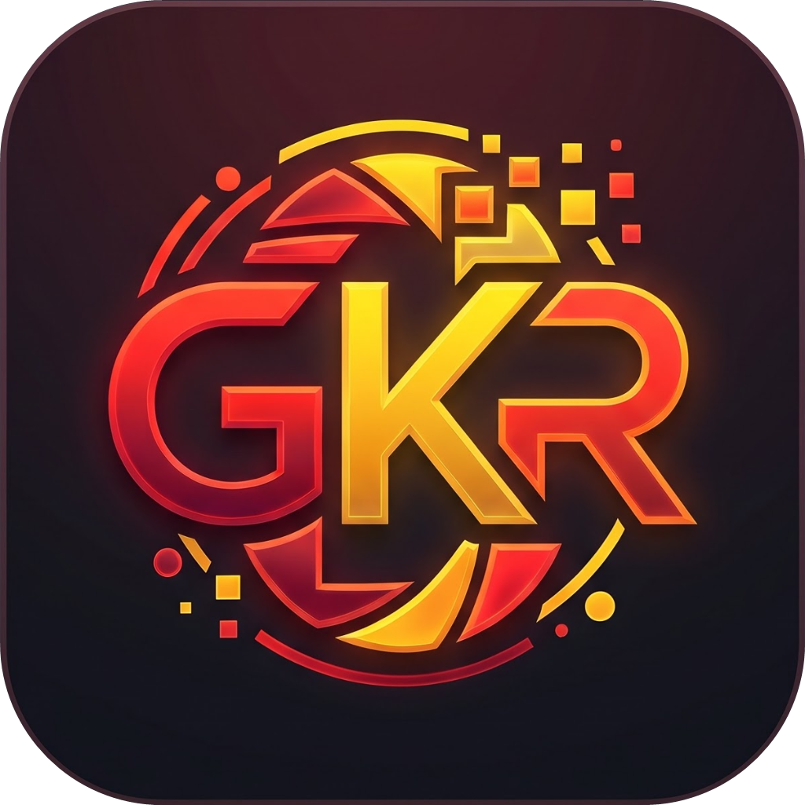
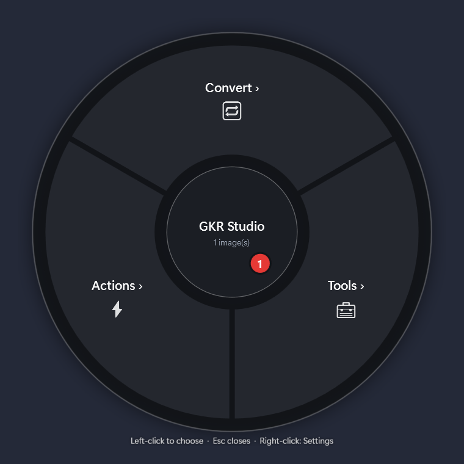
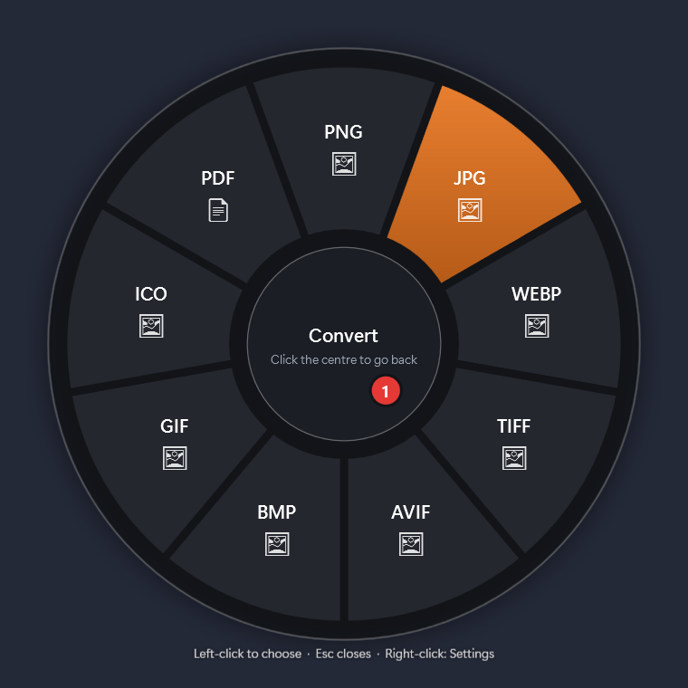
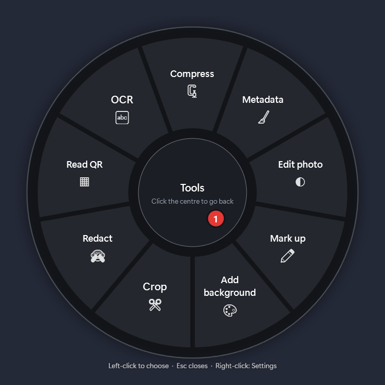
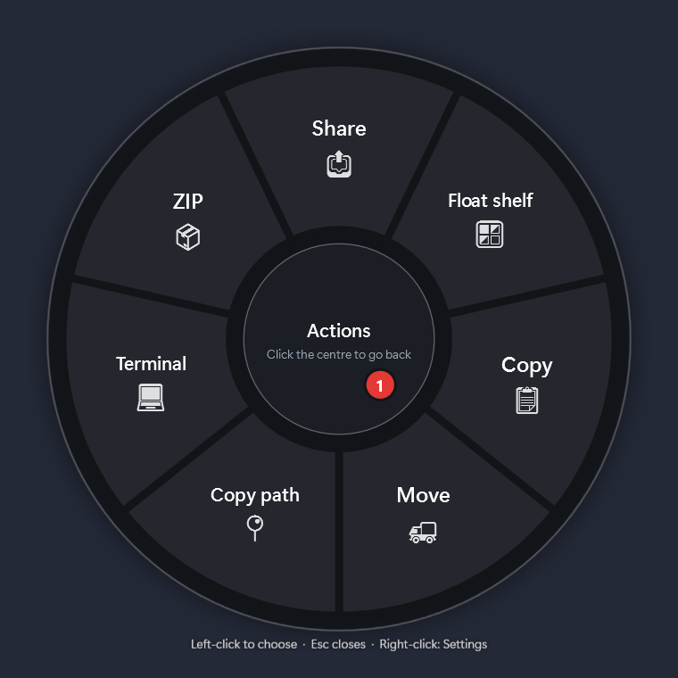
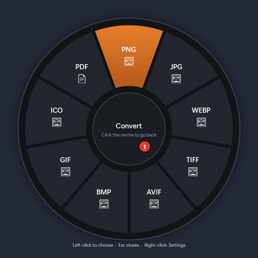

<p align="center"></p>

# GKR Studio

> Versions before 1.2.0 cannot update themselves to this release: install GKR Studio once with the links below (settings carry over).

Convert, edit and download files straight from a radial wheel — on **Windows** and **macOS**.

<p align="center">
  
  
</p>
<p align="center">
  
  
</p>

## Download

| Platform | Package |
|---|---|
| Windows 10/11 (64-bit) | [GKRStudio-win-x64.zip](https://github.com/gokerbekir66/gkrstudio-releases/releases/latest/download/GKRStudio-win-x64.zip) |
| Mac with Apple silicon (M-series, A-series) | [GKRStudio-macos-arm64.zip](https://github.com/gokerbekir66/gkrstudio-releases/releases/latest/download/GKRStudio-macos-arm64.zip) |
| Mac with Intel processor | [GKRStudio-macos-x64.zip](https://github.com/gokerbekir66/gkrstudio-releases/releases/latest/download/GKRStudio-macos-x64.zip) |

### macOS: one-line install (recommended)

Open **Terminal** and paste:

```bash
curl -fsSL https://github.com/gokerbekir66/gkrstudio-releases/releases/latest/download/install-mac.sh | bash
```

It picks the right package for your Mac, installs GKR Studio into Applications and starts it.
Then enable GKR Studio in **System Settings → Privacy & Security → Accessibility**.

### Windows: one-line install (recommended)

Open **PowerShell** and paste:

```powershell
irm https://github.com/gokerbekir66/gkrstudio-releases/releases/latest/download/install-windows.ps1 | iex
```

It installs GKR Studio in your user folder (no admin rights needed), adds it to the Start menu and starts it. Answer **Yes** on first start.

Or download the ZIP from the table above, extract it and run `GKRStudio.exe` (if SmartScreen appears: **More info → Run anyway**).

## Features

- **Shift / Ctrl / Alt + right-click** (Mac: Shift / ⌘ Command / ⌥ Option): Convert · Tools · Actions wheels
- Images, video, audio, PDF, documents, spreadsheets, presentations, EPUB, subtitles and archives
- Download video / MP3 from YouTube and many other sites (optionally with your browser's cookies), OCR, QR code reading
- English, Turkish, Dutch and French
- Signed automatic updates

FFmpeg (GPL), yt-dlp and Deno are bundled in the Windows package; licenses and source links are in `tools/LISANSLAR.txt`.

## Lion-bite animation 🦁

With **Settings → Lion-bite animation when choosing** turned on, the lion bites the slice you pick.

<p align="center">
  
</p>

## Settings

Right-click menu, background mode and key + right-click wheels, language (English, Turkish, Dutch, French), theme and accent colour, signed updates, external tools, downloads from a copied link and file conversion.

<p align="center">
  
</p>
